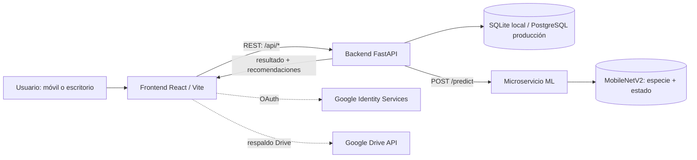

# AgroPlantas Colombia

Aplicación web para identificar especies agrícolas y orientar sobre estados fitosanitarios a partir de una fotografía. Incluye cuenta de usuario, historial privado, biblioteca de cultivos, recomendaciones, soporte y ajustes de accesibilidad.

> **Importante antes de publicarla:** la selección de planes está disponible como vista informativa; no hay pasarela de pagos ni activación de suscripciones. En este momento el backend aplica el mismo límite de seis análisis cada 24 horas a usuarios con sesión e invitados. La identificación es una orientación y no reemplaza el diagnóstico de un profesional agrícola.

## Funciones disponibles

- Captura desde cámara o carga de imágenes JPG, PNG y WEBP (máximo 10 MB).
- Identificación con un modelo de dos etapas: especie y estado de la planta.
- Resultados con confianza, alternativas, estado, plaga/enfermedad y recomendaciones agronómicas.
- Biblioteca y fichas de las clases disponibles en el modelo.
- Registro, inicio de sesión con correo/contraseña y Google, recuperación de contraseña y perfil.
- Historial asociado a la cuenta, descarga JSON y copia de seguridad JSON en Google Drive.
- Cuota de seis análisis por cada ventana de 24 horas por usuario o identificador de invitado.
- Preferencias de tema, tamaño de texto, idioma español/inglés y notificaciones del navegador compatibles.
- Centro de soporte, preguntas frecuentes, consentimiento de cookies y enlaces a las políticas proporcionadas.
- Planes Pro/Premium preparados pero ocultos durante la presentación institucional mediante `COMMERCIAL_PLANS_ENABLED`; el cobro no está implementado.

## Arquitectura

La aplicación se ejecuta como tres partes separadas:

1. **`frontend/`**: React, TypeScript y Vite; navegación, cámara/carga, sesión del navegador y presentación de resultados.
2. **`backend/`**: FastAPI; autenticación, PostgreSQL/SQLite, cuota, catálogo, recomendaciones e historial. Reenvía las imágenes al servicio ML.
3. **`ml_service/`**: FastAPI + TensorFlow/Keras; carga los modelos y calcula probabilidades. No administra cuentas ni la base de datos.



El detalle de módulos, rutas, fases del análisis y funciones principales está en [docs/ARQUITECTURA.md](docs/ARQUITECTURA.md). La metodología de entrenamiento está en [frontend/docs/METODOLOGIA.md](frontend/docs/METODOLOGIA.md), y las variables sensibles/configuración en [docs/SEGURIDAD.md](docs/SEGURIDAD.md).

## Inicio local en Windows

Usa Python 3.11. Abre **tres terminales** en la carpeta raíz del repositorio. En la primera ejecución crea y activa el entorno e instala las dependencias necesarias:

```powershell
py -3.11 -m venv .venv311
.\.venv311\Scripts\Activate.ps1
python -m pip install -r requirements-backend.txt
python -m pip install -r requirements-ml.txt
```

Configura `backend/.env` con:

```dotenv
ML_SERVICE_URL=http://127.0.0.1:8001
```

Si vas a probar autenticación Google local, copia `frontend/.env.example` a `frontend/.env` y agrega el OAuth Client ID público autorizado para `http://localhost:3000`. Copia `backend/.env.example` a `backend/.env` y configura el mismo Client ID como `GOOGLE_CLIENT_ID`.

**Terminal 1 — backend (puerto 8002):**

```powershell
cd backend
..\.venv311\Scripts\Activate.ps1
uvicorn main:app --reload --host 0.0.0.0 --port 8002
```

**Terminal 2 — inferencia ML (puerto 8001):**

```powershell
cd ml_service
..\.venv311\Scripts\Activate.ps1
uvicorn main:app --reload --host 0.0.0.0 --port 8001
```

**Terminal 3 — frontend (puerto 3000):** desde la raíz del repositorio:

```powershell
npm.cmd --prefix frontend install
npm.cmd run dev
```

El script de la raíz dirige el comando al frontend. Abre `http://localhost:3000`; la documentación del backend está en `http://localhost:8002/docs`. Vite reenvía `/api` y `/health` al backend en el puerto 8002. Si el puerto 3000 ya está ocupado, detén el Vite anterior antes de iniciar otro.

Para usar la app desde otro teléfono en la misma red, abre `http://<IP-DE-TU-PC>:3000`. La cámara/notificaciones y Google pueden requerir HTTPS; el inicio OAuth de Google admite `localhost` para desarrollo, pero no una IP privada en HTTP. Consulta [docs/SEGURIDAD.md](docs/SEGURIDAD.md).

## Entrenar o evaluar el modelo

El entrenamiento es opcional para ejecutar la aplicación: los artefactos están en `models/`. Los datos crudos y procesados no se incluyen en Git.

```powershell
python scripts/prepare_dataset.py --input data/raw
python scripts/train.py --data data/processed --epochs 12
python scripts/evaluate.py --data data/processed
```

`models/training_metrics.json` registra métricas de entrenamiento/validación del artefacto disponible. **No uses el `accuracy: 1.0` de `models/evaluation_report.json` como resultado de evaluación del clasificador actual:** ese archivo reporta una sola clase llamada `PlantVillage`, por lo que no es una evaluación válida de las 93 clases. Regenera el informe con un conjunto TEST compatible y valida con fotografías de campo antes de presentar una precisión de producción.

## Estructura principal

```text
backend/          API, autenticación, cuota, catálogo e historial
ml_service/       API de inferencia TensorFlow/Keras aislada
frontend/         React, rutas, componentes, estado y estilos
models/           Modelos Keras y metadatos de clases/métricas
scripts/           Preparación de datos, entrenamiento, evaluación y backup DB
docs/              Arquitectura, seguridad, dataset y evaluación piloto
requirements-backend.txt
requirements-ml.txt
```

## Estado de integración para la entrega

- Google OAuth, Drive, SMTP de recuperación, base PostgreSQL y dominios permitidos necesitan credenciales/configuración reales en sus proveedores.
- La recuperación de contraseña no envía correo hasta configurar SMTP.
- La copia en Drive requiere activar Drive API y autorizar los alcances indicados en [docs/SEGURIDAD.md](docs/SEGURIDAD.md).
- La pantalla de planes y pago es solo una revisión de precio; no pide tarjetas, no cobra y no actualiza el plan del usuario.
- La pantalla comercial está apagada por defecto en `frontend/src/lib/features.ts`; no la actives hasta configurar pagos y beneficios de planes.
- La política de privacidad y cookies se enlaza desde `/privacidad`; los dos documentos de Google Docs deben tener acceso público de lectura para usuarios y Google OAuth.
- En producción despliega `frontend/` en Vercel y configura backend y ML como servicios accesibles por HTTPS, con PostgreSQL persistente. No uses SQLite ni secretos de desarrollo en producción.

## Licencia

Prototipo académico para uso educativo e investigación agrícola. Revisa las licencias y atribuciones de cada dataset y dependencia antes de redistribuirlo.
