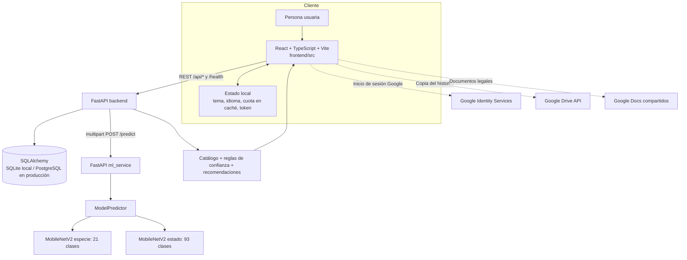

# Arquitectura y funcionamiento del sistema

## Propósito y alcance

AgroPlantas Colombia recibe una imagen y devuelve una clasificación orientativa sobre el cultivo/especie y su estado. El catálogo actualmente asociado al modelo contiene 21 especies y 93 clases de estado. El sistema puede indicar una salida como no reconocida si las probabilidades no superan las reglas de confianza. No es un diagnóstico agronómico certificado.

## Vista general

### Responsabilidades y límites

| Parte | Responsabilidad | No hace |
|---|---|---|
| `frontend/` | Navegación, cámara/archivo, formularios, accesibilidad, localización, presentación y llamadas HTTP. | No valida credenciales de Google por sí sola; el backend verifica el ID token. |
| `backend/` | Reglas de negocio, tokens JWT, usuarios, cuotas, historial, catálogo, CORS y comunicación con ML. | No carga TensorFlow en el proceso principal. |
| `ml_service/` | Validar imagen, preprocesar y ejecutar los clasificadores Keras. | No conoce usuarios ni persiste historial. |
| Base de datos | Usuarios, identidades OAuth, tokens de restablecimiento, identificaciones y ventana de cuota. | En producción no debe ser SQLite local efímero. |
| Google | Autenticación social y creación de un archivo de backup en el Drive privado cuando la persona lo autoriza. | No es un servicio obligatorio para identificar imágenes o usar correo/contraseña. |

La separación del servicio ML evita cargar TensorFlow junto con la conexión a PostgreSQL en el proceso transaccional. El backend llama a ML mediante `ML_SERVICE_URL` y un request HTTP.

## Modelo de inteligencia artificial

### Clasificadores

El sistema usa transferencia de aprendizaje con **MobileNetV2 preentrenada en ImageNet**, entrada de 224 × 224 RGB y normalización `preprocess_input` de MobileNetV2.

1. **Clasificador de especie** (`models/species_classifier.keras`): 21 clases, como arroz, cacao, café, cítricos, fríjol, mango, plátano, tomate y yuca.
2. **Clasificador de estado** (`models/plant_classifier.keras`): 93 clases de la forma `Especie___Condición`, con clases sanas y distintas plagas/enfermedades.

Cada clasificador usa el backbone MobileNetV2 sin la cabeza original de ImageNet, Global Average Pooling, Dropout y capas densas con Softmax. En entrenamiento se congela primero la base preentrenada; luego se hace fine-tuning de las últimas 30 capas, manteniendo BatchNormalization congeladas. Se emplea Adam, entropía cruzada categórica dispersa, pesos por clase limitados y callbacks de parada temprana, reducción del learning rate y guardado del mejor checkpoint.

La lista ordenada de clases en `models/class_names.json` y `models/species_class_names.json` debe corresponder exactamente con las salidas Softmax de cada modelo. No reordenar esos archivos a mano.

### Inferencia paso a paso

1. El frontend recibe una imagen desde cámara o archivo. Se aceptan JPG/JPEG, PNG o WEBP con máximo de 10 MB.
2. El backend valida el tipo/tamaño, identifica al usuario o invitado, consulta la cuota y registra el intento antes de consultar ML.
3. El backend remite el archivo al `POST /predict` de `ml_service`.
4. `ml_service` convierte a RGB, toma un recorte cuadrado centrado, redimensiona a 224 × 224 y aplica `preprocess_input`.
5. El predictor ejecuta ambos modelos. Actualmente la inferencia usa una vista de imagen por rapidez; no usa TTA de tres variantes.
6. El clasificador de especie limita las clases de estado admisibles: se conservan especies con probabilidad de al menos 25% respecto a la especie de máxima probabilidad. Las probabilidades se renormalizan; si el filtro elimina todo, se conserva la salida sin filtrar.
7. El backend combina las salidas, ordena alternativas, determina especie/condición y aplica umbrales configurables en `supported_species.py` para abstenerse cuando no reconoce con suficiente seguridad.
8. `recommendations.py` usa catálogo y conocimiento agronómico para completar el resultado.
9. Se devuelve `PredictionResponse`; si hay sesión, el frontend puede guardar el resultado y una miniatura en `/api/history`. Sin sesión, el resultado solo se conserva temporalmente en la interfaz.

### Métricas y limitaciones conocidas

`models/training_metrics.json` registra entrenamiento del 2 de agosto de 2026. Reporta accuracy final de validación de 0.9599 en especie y 0.8553 en estado. Estas cifras corresponden a la partición de validación de entrenamiento; por sí solas no prueban el rendimiento en fincas ni en dispositivos/fotografías nuevas.

El archivo actual `models/evaluation_report.json` contiene una sola clase (`PlantVillage`) y 8.147 muestras con accuracy 1.0. No corresponde a la taxonomía de 93 clases, por lo que **no es evidencia válida de precisión del modelo de producción**. Antes de publicar métricas, genera un conjunto TEST independiente con las mismas clases y vuelve a ejecutar `scripts/evaluate.py`. Completa además el piloto de campo de [EVALUACION_PILOTO.md](EVALUACION_PILOTO.md).

## Funciones de la aplicación

### Rutas frontend

Todas las rutas se montan en `frontend/src/App.tsx` dentro de `DashboardLayout`.

| Ruta | Función | Acceso |
|---|---|---|
| `/` | Inicio, resumen de cuota y acceso a identificar. | Público |
| `/identificar` | Cargar/tomar foto, procesar, ver resultado y guardar si hay sesión. | Público, cuota aplicada por backend |
| `/login` | Registro, correo/contraseña, Google y recuperación de contraseña. | Público |
| `/mis-identificaciones` | Lista de historial de la cuenta. | Requiere sesión |
| `/biblioteca`, `/biblioteca/:className` | Explorar especies/condiciones y fichas del catálogo. | Requiere sesión |
| `/diagnosticos-ia` | Resúmenes y estadísticas calculados a partir del historial guardado. | Requiere sesión |
| `/historial` | Consultar/borrar identificaciones guardadas. | Requiere sesión |
| `/ajustes` | Perfil, estado del modelo, backup, exportación, tema, texto, idioma y notificaciones. | Requiere sesión |
| `/consejos` | Recomendaciones generales de manejo. | Requiere sesión |
| `/soporte`, `/preguntas-frecuentes` | Formulario `mailto:` y preguntas filtrables/desplegables. | Público |
| `/planes`, `/pago/:planId` | Páginas informativas de planes/pago, ocultas por defecto. Con `COMMERCIAL_PLANS_ENABLED = false`, ambas redirigen al inicio. No procesan pagos. | Público cuando se habilite |
| `/privacidad` | Enlaces a las políticas de Google Docs facilitadas por el responsable. | Público |
| `/favoritos` | Actualmente muestra una pantalla placeholder; no es un módulo de favoritos implementado. | Requiere sesión |

Funciones transversales: tema oscuro/claro, escala de fuente, idioma español/inglés, consentimiento de cookies y cuota visible. `frontend/src/lib/features.ts` centraliza el interruptor comercial, desactivado para la presentación institucional; el aviso de cuota ofrece soporte en vez de vender un plan. El consentimiento se persiste en `agroplantas_cookie_consent` durante 180 días. No se cargan herramientas de analítica o publicidad opcionales; por ello, la opción “Aceptar todas” todavía no habilita cookies adicionales.

### Backend HTTP

La API principal se documenta automáticamente en `/docs`.

| Método/ruta | Comportamiento |
|---|---|
| `GET /` | Estado y versión del backend. |
| `GET /health` | Estado del backend, estado del ML, clases y métricas presentes. |
| `GET /api/classes` | Nombres de las clases del modelo. |
| `GET /api/supported-species` | Especies aceptadas por la lógica de reconocimiento. |
| `GET /api/plant-info/{class_name}` | Ficha agronómica de una clase conocida. |
| `GET /api/plant-image/{class_name}` | Imagen de muestra si el dataset existe en ese despliegue. |
| `GET /api/guest/quota` | Cuota y reinicio para la identidad de usuario/invitado. |
| `POST /api/predict` | Valida cuota/archivo, invoca ML y compone las recomendaciones. |
| `POST /api/auth/register`, `/login` | Crear cuenta o recibir JWT. |
| `POST /api/auth/social/google` | Verificar ID token de Google y abrir/crear usuario. |
| `POST /api/auth/password/forgot`, `/reset` | Solicitar y consumir token de recuperación. Requiere SMTP para entregar el correo. |
| `GET /api/auth/me`, `PUT /api/auth/me`, `PUT /api/auth/me/avatar` | Consultar/actualizar perfil y avatar. |
| `POST /api/auth/backup/google-drive` | Validar autorización de Drive y crear un JSON privado con perfil/historial. |
| `GET/POST/DELETE /api/history` | Listar, guardar y borrar historial del usuario autenticado. |
| `DELETE /api/history/{id}` | Borrar una identificación propia. |

El microservicio ML expone un API separado:

| Método/ruta ML | Comportamiento |
|---|---|
| `GET /` | Identifica el proceso como `ml-service`. |
| `GET /health` | Informa si están cargados los modelos y cuántas clases/especies tiene. |
| `GET /classes` | Devuelve etiquetas de especie y estado cargadas. |
| `POST /predict` | Recibe multipart con una imagen y retorna listas alineadas de clases/probabilidades. |

### Módulos principales y funciones

| Módulo/función | Responsabilidad |
|---|---|
| `backend/main.py:predict` | Orquesta cuota, validación, request a ML, análisis y esquema de respuesta. |
| `backend/main.py:_guest_hash` / `_analysis_subject_hash` | Valida y anonimiza el ID de invitado o genera identidad de cuota a partir del usuario. |
| `backend/main.py:_analysis_quota_status` / `_consume_analysis_attempt` | Lee/actualiza el contador persistente para una ventana de 24 h. Actualmente el backend aplica seis intentos a todas las cuentas; no existe diferencia efectiva de cupo pago. |
| `backend/main.py:health_check` | Consulta el servicio ML y publica estado/clases/métricas disponibles. |
| `backend/prediction_utils.py:analyze_predictions` | Agrega probabilidades por cultivo, selecciona clase/estado, alternativas y etiqueta casos no reconocidos. |
| `backend/recommendations.py:generate_recommendations` | Construye ficha, severidad, descripción, causas, tratamiento, prevención y contexto ambiental a partir del catálogo. |
| `ml_service/main.py:predict` | Valida carga, abre la imagen y devuelve probabilidades de estado/especie. |
| `ml_service/models/predictor.py:ModelPredictor.load_model` / `load_species_model` | Carga cada modelo y sus mapas de etiquetas; la segunda etapa es opcional para compatibilidad con modelos anteriores. |
| `ModelPredictor._apply_species_gate` | Filtra/renormaliza clases de estado según el resultado del clasificador de especie. |
| `ModelPredictor.predict` / `predict_image` | Ejecuta las redes y devuelve promedios sobre variantes generadas por preprocesamiento. |
| `image_utils.center_crop_square` / `preprocess_pil` / `tta_variants` | Estandariza proporción, tamaño y normalización. En producción la variante actual produce una sola vista. |
| `backend/auth_utils.py:hash_password`, `verify_password`, `create_access_token`, `decode_access_token` | Hash de contraseñas y ciclo de vida del JWT. |
| `backend/security.py:AuthRateLimitMiddleware` | Limita intentos de autenticación y puede emitir alertas configuradas. |
| `backend/routers/history.py` | CRUD de identificaciones, siempre acotado a la identidad autenticada. |
| `frontend/src/lib/authStore.ts` | Registro, inicio/cierre, Google, token, perfil y llamada de backup. |
| `frontend/src/lib/historyStore.ts` | Normaliza historial API, genera miniatura y exporta/borra datos desde UI. |
| `frontend/src/lib/guestQuota.ts` | Identificador local de invitado, consulta cuota y emite eventos UI; el backend conserva la autoridad del límite. |
| `frontend/src/lib/notifications.ts` | Pide permiso y muestra notificación del sistema al terminar un análisis; depende de navegador y service worker compatibles. |
| `frontend/src/lib/themeStore.tsx` / `languageStore.tsx` | Persiste tema, escala de fuente e idioma en el navegador. |
| `frontend/src/components/RequireAuth.tsx` | Restringe rutas de historial/ajustes y conduce a login. |

### Pipeline de ML y operaciones

| Fase/script | Funciones principales |
|---|---|
| Preparación: `scripts/prepare_dataset.py` | `find_class_folders`/`scan_*_source` descubren fuentes; `load_manifest` lee configuración; `merge_sources` unifica etiquetas; `split_and_copy` produce train/val/test; `main` valida argumentos y ejecuta. |
| Entrenamiento: `scripts/train.py` | `build_model` construye MobileNetV2 y cabeza; `build_augmentation` transforma solo entrenamiento; `load_dataset`/`preprocess_dataset` cargan y normalizan; `calculate_*_weights` corrigen desbalance; `convert_state_to_species_dataset` obtiene etiquetas de especie; `create_callbacks` define checkpoints/parada; `train_stage` congela y luego afina; `main` entrena especie y estado y guarda artefactos/métricas. |
| Evaluación: `scripts/evaluate.py` | Carga artefactos y conjunto test, valida compatibilidad entre clases, predice y exporta reporte de clasificación/matriz de confusión. Requiere un test válido. |
| Backup DB: `scripts/backup_database.py` | `backup_sqlite` genera una copia consistente; `backup_postgres` invoca `pg_dump`; `prune_old_backups` elimina copias vencidas; `main` selecciona destino/extensión y trata errores. El archivo no se cifra ni se sube automáticamente. |

## Persistencia, cuotas y datos

- Desarrollo: SQLite local en `backend/agroplantas.db`.
- Producción: PostgreSQL persistente mediante `DATABASE_URL`; el backend bloquea el inicio productivo sin PostgreSQL.
- El JWT se guarda en `localStorage` del navegador. No es una cookie de sesión HttpOnly.
- El historial de usuarios autenticados se guarda en la base de datos; la miniatura JPEG se almacena con el registro. Un análisis sin sesión no crea historial de cuenta.
- El límite implementado es seis análisis por identidad y ventana móvil de 24 h, para invitados y autenticados. Los planes no cambian este límite todavía.
- Datos raw/processed no forman parte de Git; se necesitan para reentrenar o ejecutar imágenes de muestra.

## Fases del producto

1. **Datos y catálogo:** reunir datasets, normalizar etiquetas, revisar correspondencias y separar train/validation/test.
2. **Entrenamiento:** entrenar clasificador de especie, luego clasificador de estado; guardar mapas y pesos compatibles.
3. **Inferencia:** recibir archivo, preprocesarlo de forma idéntica y ejecutar el servicio ML aislado.
4. **Reglas agronómicas:** interpretar clase, calcular reconocimiento/confianza y añadir información del catálogo.
5. **Experiencia web:** captura/carga, resultados, biblioteca, soporte, accesibilidad, cuotas e historial.
6. **Identidad y respaldo:** correo/contraseña, Google OAuth, perfil, recuperación y exportación/Drive con consentimiento.
7. **Operación y despliegue:** Vercel, backend/ML HTTPS, PostgreSQL, secretos, SMTP, monitorización y restauración de backups.
8. **Validación antes de lanzamiento:** evaluación multiclase válida, piloto de campo, revisión legal/documentos públicos, pruebas de flujos reales y activación de pasarela antes de vender planes.

## Configuración y límites de despliegue

Consulta [README.md](../README.md) para inicio local y [SEGURIDAD.md](SEGURIDAD.md) para OAuth, SMTP, base productiva, dominios, backups y cabeceras. El frontend se publica desde `frontend/`; ML debe copiar los modelos en el despliegue. Cada servicio necesita HTTPS y URL/CORS compatibles. El host de los documentos Google Docs debe permitir lectura pública si se entrega como política.

`docker-compose.yml` es una configuración anterior de dos servicios: no inicia `ml_service` como proceso separado y usa el puerto 8000 para el backend. No es la ruta de desarrollo documentada ni se debe asumir que representa la topología productiva actual; usa los tres comandos locales del README o actualiza Compose antes de depender de él.

No están implementados cobros ni webhooks de pago, asignación de plan Premium/Pro, cuotas premium, favoritos persistentes, notificaciones push remotas, ni flujo automatizado de eliminación completa de cuenta. Mantén `COMMERCIAL_PLANS_ENABLED` en `false` durante la presentación institucional. Solo cámbialo a `true` después de conectar y probar la pasarela, asignación de planes y sus límites desde el backend.
